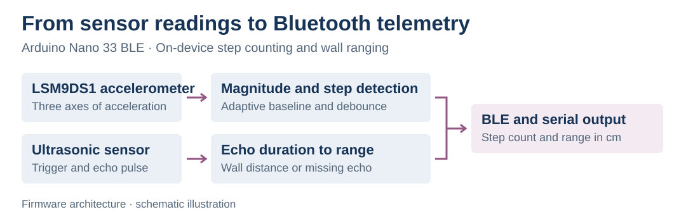
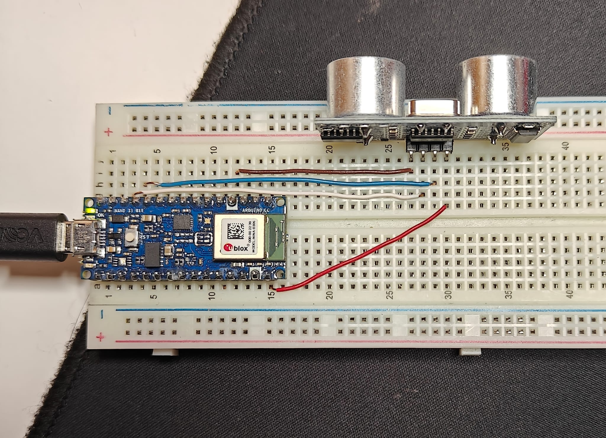

# BLE Sensor Pedometer

[](https://github.com/martaforjaz/ble-sensor-pedometer/actions/workflows/reproduce.yml)

An Arduino portfolio prototype that counts steps from an onboard accelerometer and sends the count alongside ultrasonic wall-range readings over Bluetooth Low Energy.



## Original IST prototype

The submitted prototype used register-level I²C, interrupt-based ultrasonic ranging, and peak–valley step detection. Across three trials per condition, the team reported mean step-count errors of **1.27%** for straight walking, **4.67%** for slow walking, and **7.30%** for irregular pace. These results apply to the submitted firmware.



[Original firmware](ist-submission/entrega/entrega.ino) · [Submitted report with personal details redacted](ist-submission/report.pdf) · [Trial counts and signal plots](ist-submission/)

## Reproduce the build and results

From the repository root, with Arduino CLI 1.2.2 and Python 3 available:

```bash
bash scripts/build.sh
python3 scripts/summarize_trials.py
```

The build script installs pinned board and library versions and compiles both sketches for the original Nano 33 BLE. The Python script verifies the nine trial counts and reproduces the published mean errors from the rounded per-trial errors in the report.

## Portfolio implementation

## Hardware and setup

- Original [Arduino Nano 33 BLE](https://docs.arduino.cc/hardware/nano-33-ble/) with the LSM9DS1.
- HC-SR04 or equivalent ultrasonic module, with a common ground and module-appropriate power.
- D9 for trigger and D10 for echo. Use a level shifter or suitable divider for a 5 V echo output. The Nano GPIO is 3.3 V only. Verify that the module accepts the trigger voltage.
- Arduino IDE with the Arduino Mbed OS Nano Boards core, ArduinoBLE and Arduino_LSM9DS1 libraries.

Open `firmware/pedometer/pedometer.ino`, select **Arduino Nano 33 BLE**, and upload. Open the serial monitor at 115200 baud or connect to **Sensor Pedometer** in a BLE client and subscribe to characteristic `93426601-02de-4f17-ac9d-24f41bbfc140`.

## What to expect

The accelerometer path computes the magnitude of the three axes, subtracts a slowly varying baseline, and counts upward threshold crossings with hysteresis and a minimum interval. The ultrasonic path separately converts echo time to wall distance. An echo timeout produces a range of `-1`.

The device emits `steps,wall_distance_cm` once per second. For example, `12,84.0` is an illustrative packet for 12 detected steps and an 84 cm wall-distance reading. Wall distance is a separate measurement and depends on orientation and the reflecting surface.

## Bench check

1. Hold the device still and record the count for 30 seconds.
2. Walk 20 manually counted steps and compare the detected count.
3. Point the ranger at a flat target at two measured distances and check the readings.
4. Remove the target beyond the configured echo window and check that the missing-range marker appears.

Thresholds depend on placement and gait. The bounded echo wait can still interrupt IMU sampling, and the project does not report measured accuracy for this portfolio implementation.

## Project background

Independent portfolio implementation inspired by the IST *Technologies of Computing Systems* pedometer project by João Maria Leitão, Marta Pereira, and Tiago Belo. The original group deliverables and code are separate.
