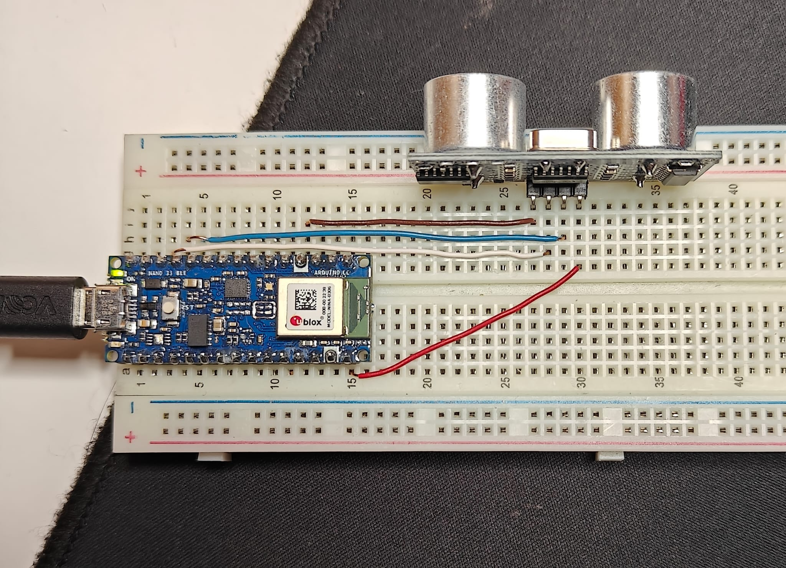
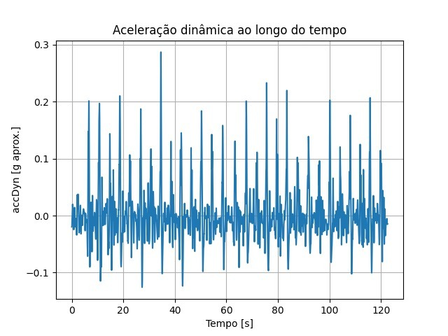
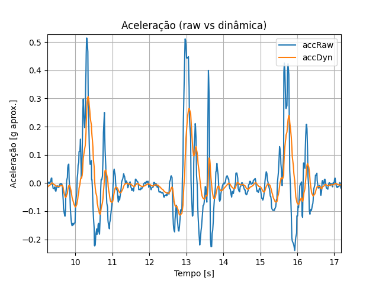
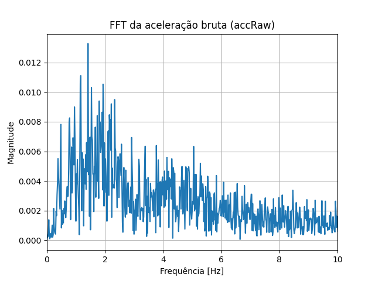

# Original IST pedometer submission

Technologies of Computing Systems, Instituto Superior Técnico. Team: João Maria Leitão, Marta Pereira, and Tiago Belo.

[Submitted firmware](entrega/entrega.ino) · [Submitted report](report.pdf)

The firmware is the sketch from the final submission archive. The public PDF preserves the report's technical content and omits student IDs, email addresses, and author portraits.

## Step-count evaluation

Table I of the submitted report gives three trials per walking condition. Each pair below is manually counted → detected steps. The mean errors are those reported by the team.

- **Straight walk (60 m)** — 80 → 79, 82 → 81, 79 → 78. Mean error **1.27%**.
- **Slow walk (40 m)** — 64 → 61, 66 → 63, 63 → 60. Mean error **4.67%**.
- **Irregular pace (30 m)** — 50 → 47, 52 → 48, 49 → 45. Mean error **7.30%**.

These are small prototype trials. The table evaluates step counts, while the ultrasound sensor provides a wall-relative range for estimating step length.

## Original report figures

**Prototype circuit.** The Arduino Nano 33 BLE and ultrasonic module on a breadboard.

**Walking trace.** Approximately 120 seconds of filtered dynamic acceleration.

**Filtering detail.** Raw and dynamic acceleration over a short window.

**Frequency analysis.** FFT of the raw accelerometer signal.

