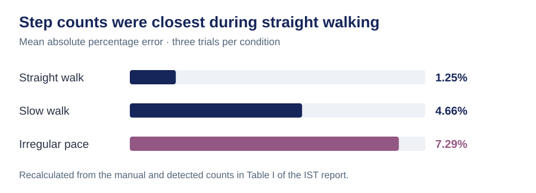

# Original IST pedometer submission

Technologies of Computing Systems, Instituto Superior Técnico. Team: João Maria Leitão, Marta Pereira, and Tiago Belo.

[Submitted firmware](entrega/entrega.ino) · [Submitted report](report.pdf)

The firmware is the sketch from the final submission archive. The public PDF preserves the report's technical content and omits student IDs, email addresses, and author portraits.

## Step-count evaluation

Table I of the submitted report gives three trials per walking condition. Each pair below is manually counted → detected steps. The mean errors are those reported by the team.

- **Straight walk (60 m)** — 80 → 79, 82 → 81, 79 → 78. Mean error **1.27%**.
- **Slow walk (40 m)** — 64 → 61, 66 → 63, 63 → 60. Mean error **4.67%**.
- **Irregular pace (30 m)** — 50 → 47, 52 → 48, 49 → 45. Mean error **7.30%**.

These are small prototype trials. The table evaluates step counts, while the ultrasound sensor provides a wall-relative range for estimating step length.

[Download the nine trial records as CSV](trials.csv). From the repository root, run `python3 scripts/summarize_trials.py` to verify the per-trial rounding and reproduce the scenario means. The script also prints means recalculated directly from step counts, which can differ slightly because of rounding.

## Run the submitted firmware

Use the original Nano 33 BLE with its LSM9DS1 and connect the ultrasonic trigger to D9 and the echo to D10, with shared ground. The Nano GPIO is 3.3 V only. Level-shift a 5 V echo signal before connecting it.

Compile with `bash scripts/build.sh` from the repository root. The archived sketch contains an identifier typo, `filtererdDistance`. The build script replaces it with `filteredDistance` in a temporary copy. Make that same one-line correction in your own copy before uploading through Arduino IDE. Open the serial monitor at 9600 baud or connect to **PM belo** and subscribe to characteristic `12345678-1234-5678-1234-56789abcdef1`. The report records the walking conditions. The four figures are preserved from the submission, which contains no raw IMU time series for regenerating the signal plots.

## Original report figures

**Prototype circuit.** The Arduino Nano 33 BLE and ultrasonic module on a breadboard.

**Walking trace.** Approximately 120 seconds of filtered dynamic acceleration.

**Filtering detail.** Raw and dynamic acceleration over a short window.

**Frequency analysis.** FFT of the raw accelerometer signal.

